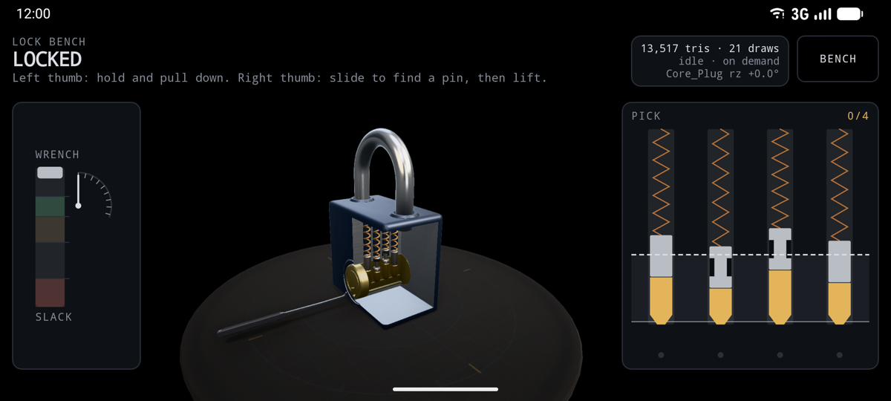
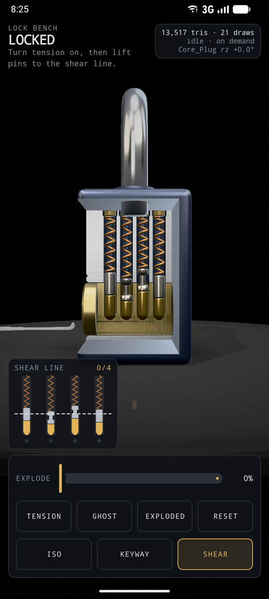

# Lock Bench

An Android lockpicking bench: a 3D cutaway pin-tumbler padlock you pick with two thumbs. Hold tension on the plug with one, feel for the pins with the other and lift them to the shear line, and watch the mechanism move inside the housing.

Built with Jetpack Compose and [SceneView](https://github.com/SceneView/sceneview) (Filament).

<p align="center">
  
  
  
  
</p>

<p align="center"><sub>Cutaway (ISO) · Shear line · Ghost · Exploded</sub></p>

## How to pick it

Hold the phone in landscape, in two hands, the way you would hold a lock and a pick: one thumb keeps tension on the plug, the other works the pick.

1. **Left thumb, tension.** Hold anywhere in the **WRENCH** zone and pull down. How far you pull is how hard you tension; let go and every pin drops.
2. **Right thumb, pick.** The **PICK** pad works like a trackpad. Slide across it to move the pick in and out along the keyway, and slide up to lift the tip. Take your thumb off and the tip drops, but the pick stays where it was. A tap on a pin's column nudges that pin to the shear line for you.
3. The pick only lifts the pin its tip is under. Between pins it is under a land, the plug's metal between two chambers, and lifting there just knocks on it.
4. The pin that stops the plug binds. Set it and the plug creeps round, moving the bind to the next one. A binding pin drags more the harder you pull, and seizes if you pull too hard.
5. Pins 2 and 3 are spools. Once the standard pins are set the plug drops into a **false set**: it turns much further than a set is worth and hangs on a spool's waist. Keep the pick on that spool and ease the wrench until the plug turns back (counter-rotation) and the pin sets.
6. Lift a pin too far past its set and it oversets and jams. Ease the wrench and it slips back without losing the others.
7. Set all four and the shackle releases. Open the **BENCH** drawer and tap **RESET** to relock.

### Picking by feel

The lock is meant to be read through the vibration as much as the screen:

| What the pick is doing | What you feel |
| --- | --- |
| Tip slides under a pin | A soft bump. Firm if that pin is binding, faint if it is already set. |
| Lifting a pin that is free on its spring | Faint, even ticks that firm up as the spring compresses. |
| Lifting the binding pin | A coarse scrape, and the pin drags behind your thumb. |
| Pin sets | A crisp click, sharper the harder you are tensioning. |
| Pushing a set pin, or any pin to the top of its chamber | Dead travel, then one hard knock. |
| Lifting into a land | An immediate hard knock; a dry scrape if you drag along it. |
| Running into the back of the keyway | A dull thud. |
| Wrench takes up, or is pulled hard enough to seize a pin | A tick, then a thud. |

Sliding the pick down the keyway and noting which bump pushes back is how you find the binding pin with **HINTS** off.

The **WRENCH** zone shows the torque against the marks where a spool can pass, where it is stuck and where pins seize, and a needle for how far the plug has turned. The **PICK** pad shows each stack against the shear line, with the pick underneath.

## Views

The **BENCH** button in the top corner opens a drawer, so nothing sits under your thumbs while you pick.

| Control | What it does |
| --- | --- |
| **ISO / KEYWAY / SHEAR** | Camera presets. Tap the current one again to snap an orbited camera back. |
| **HINTS** | Names the binding pin and says what the lock is doing. Off leaves you with feel, the gauge and the motion. |
| **GHOST** | Makes the housing translucent. |
| **EXPLODED** / **EXPLODE** slider | Pulls the parts apart. |
| **SWAP HANDS** | Puts tension under the right thumb and the pick under the left. |
| **RESET** | Relocks the padlock. |

Drag anywhere between the two zones to orbit the camera, and pinch to zoom. The camera holds still while either zone is held.

## Project layout

```
app/src/main/kotlin/com/lockpicking/bench/
  domain/                 pure Kotlin, no Android, unit tested
    lock/                 LockMechanics: the pin-tumbler state machine
    bench/                BenchSimulation: frame-stepped lock, keyway, pick, plug and shackle
    model/, motion/       LockGeometry, springs, easing, RigPose, FrameClock
  data/                   LockAssetRepository and the .glb summary parser
  di/AppModule.kt         Koin module
  ui/
    bench/                LockBenchViewModel, the screen, touch routing, haptics and sound
    bench/scene/          SceneView scene and LockRig, which poses the glTF nodes
    components/           pick pad, tension zone, control drawer, status block, stats pill
    theme/                colours, type and BenchTheme
app/src/main/assets/
  models/cutaway_padlock.glb
  environments/studio.hdr
tools/
  build_padlock.py        Blender script that generates the padlock model
  make_studio_hdr.py      paints the studio lighting HDR
  inspect_glb.py          checks a .glb against the node contract
```

## Building

Requires JDK 17 and an Android SDK with API 37. Min SDK is 28.

```bash
./gradlew installDebug
```

Run the unit tests:

```bash
./gradlew test
```

### Regenerating the assets

The model and the lighting are generated from scripts, so you can change them in code:

```bash
/Applications/Blender.app/Contents/MacOS/Blender --background --python tools/build_padlock.py
```

```bash
python3 tools/make_studio_hdr.py
```

```bash
python3 tools/inspect_glb.py
```
