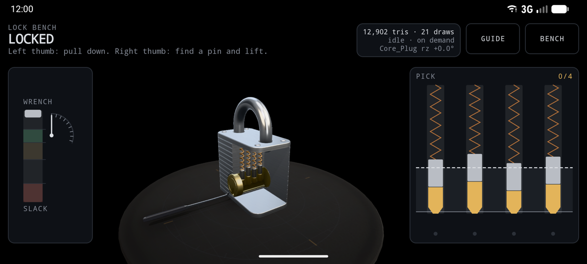
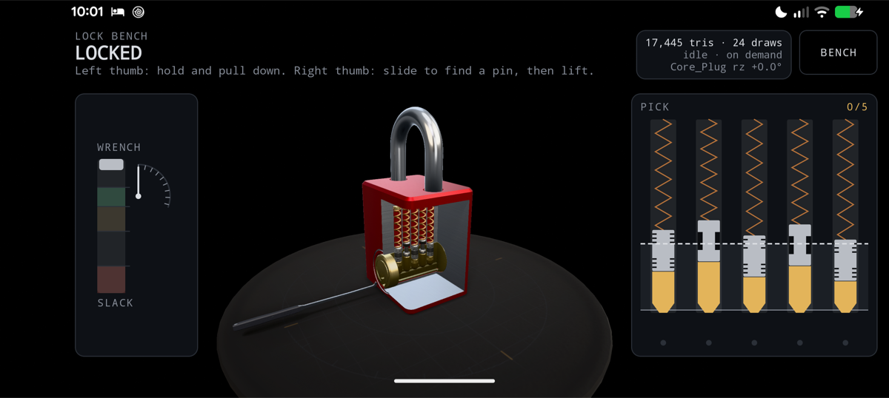
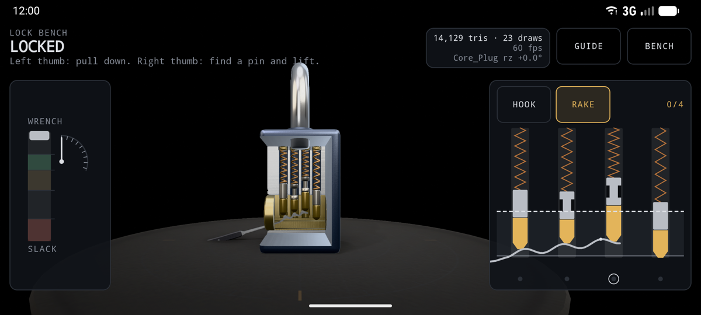
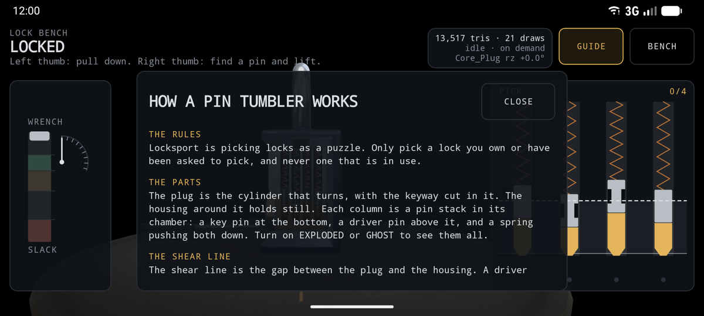

# Lock Bench

An Android lockpicking bench: 3D cutaway pin-tumbler padlocks you pick with two thumbs. Hold tension on the plug with one, feel for the pins with the other and lift them to the shear line, and watch the mechanism move inside the housing. There are three locks on the bench, from four plain pins to five that all fight back.

Built with Jetpack Compose and [SceneView](https://github.com/SceneView/sceneview) (Filament).

New to locks? [A locksport primer](docs/LOCKSPORT.md) names the parts you are looking at and explains why picking works. The same primer, shorter, is behind the **GUIDE** button in the app.

<p align="center">
  
  
</p>
<p align="center">
  
  
</p>

<p align="center"><sub>Cutaway (ISO) · Shear line under tension<br>Ghost · Exploded</sub></p>

## The locks

Pick one from the **LOCK** row of the **BENCH** drawer. Each is its own model with its own pins, and keeps its own best times.

<p align="center">
  
  
</p>

| Lock | Pins | What it is |
| --- | --- | --- |
| **TRAINER** | 4: two standard, two spools | The anodized training block the bench started with. |
| **MASTER NO. 3** | 4, all standard | Laminated steel plates and a short shackle, in the style of a Master Lock No. 3. Nothing in it fights back: lift the binding pin, hear it set, move on. The one to learn on. |
| **AMERICAN 1100** | 5: three serrated, two spools | A solid block of red anodized aluminium, in the style of an American Lock 1100, with the stacks packed closer together. Every driver in it lies to you. |

The cutaways are bench models, not replicas: the keyway is on the front face of all three, so the stacks stand upright in the window.

## How to pick it

Hold the phone in landscape, in two hands, the way you would hold a lock and a pick: one thumb keeps tension on the plug, the other works the pick.

1. **Left thumb, tension.** Hold anywhere in the **WRENCH** zone and pull down. How far you pull is how hard you tension; let go and every pin drops.
2. **Right thumb, pick.** The **PICK** pad works like a trackpad. Slide across it to move the pick in and out along the keyway, and slide up to lift the tip. Take your thumb off and the tip drops, but the pick stays where it was. A tap on a pin's column nudges that pin to the shear line for you.
3. The pick only lifts the pin its tip is under. Between pins it is under a land, the plug's metal between two chambers, and lifting there just knocks on it.
4. The pin that stops the plug binds. Set it and the plug creeps round, moving the bind to the next one. A binding pin drags more the harder you pull, and seizes if you pull too hard.
5. Some drivers are spools: pins 2 and 3 on the trainer, 2 and 4 on the American. Once the other pins are set the plug drops into a **false set**: it turns much further than a set is worth and hangs on a spool's waist. Keep the pick on that spool and ease the wrench until the plug turns back (counter-rotation) and the pin sets.
6. Lift a pin too far past its set and it oversets and jams. Ease the wrench and it slips back without losing the others.
7. A serrated driver has a ladder of fine grooves, and each one clicks on the shear line on its way up, like a set that is not one. Pull the wrench too hard and a groove catches and holds the pin there. Ease off to a light, steady pull and keep lifting through the clicks until the pin really sets and the bind moves on.
8. Set every pin and the shackle releases. Tap the shackle to relock it, or open the **BENCH** drawer and tap **RESET**.

### Picking by feel

The lock is meant to be read through the vibration as much as the screen:

| What the pick is doing | What you feel |
| --- | --- |
| Tip slides under a pin | A soft bump. Firm if that pin is binding, faint if it is already set. |
| Lifting a pin that is free on its spring | Faint, even ticks that firm up as the spring compresses. |
| Lifting the binding pin | A coarse scrape, and the pin drags behind your thumb. |
| Pin sets | A crisp click, sharper the harder you are tensioning. |
| A serration reaches the shear line | The same click, a little softer. The pin is still the one binding. |
| Pushing a serrated pin that has caught | Two dull knocks, like a spool that will not turn the plug back. |
| Pushing a set pin, or any pin to the top of its chamber | Dead travel, then one hard knock. |
| Lifting into a land | An immediate hard knock; a dry scrape if you drag along it. |
| Running into the back of the keyway | A dull thud. |
| Wrench takes up, or is pulled hard enough to seize a pin | A tick, then a thud. |

Sliding the pick down the keyway and noting which bump pushes back is how you find the binding pin with **HINTS** off.

### Raking

The **HOOK | RAKE** switch at the top of the pick pad swaps the pick in your hand. Swapping takes the pick out of the lock but leaves the wrench alone, so your tension and your sets stay.

<p align="center">
  
</p>

A rake is a wavy blade that goes under every pin at once. Hold a light wrench, slide your thumb back and forth across the pad in full strokes, and let the lift wander as you go.

| What is in the lock | What the rake does |
| --- | --- |
| **Plain pins** | Each sets as a hump carries it up through the shear line. The Master No. 3 opens in a few strokes. |
| **Spools** | Knocked about by a passing hump, a spool never squares up to the plug, so it does not set. When the plain pins have gone the plug drops into a false set and the spool holds the blade down. A rake never sets a spool, however slowly you work it. |
| **Serrated drivers** | The first groove clicks on every pass and the pin falls back. Nothing sets. |
| **Firm tension** | The peak that sets a pin throws it past the line and it jams until you ease off. Raking only works in the wrench's light band. |

To get through a serrated pin, stop scrubbing: hold one hump nearly still under the pin and rock it gently up and down, the way you would work it with the hook. Rocking does nothing for a spool: for that, swap to the hook. The trainer always ends in a false set this way, and the American 1100 gives the rake nothing but clicks.

A tap on the pad does nothing while the rake is in: it is not aimed at a pin.

The **WRENCH** zone shows the torque against the marks where a spool can pass, where it is stuck and where pins seize, and a needle for how far the plug has turned. The **PICK** pad shows each stack against the shear line, with the pick underneath.

## Blind game

The **PLAY** row in the **BENCH** drawer starts a blind round. The camera holds on the keyway from the lock's solid side, the pick pad shows only the keyway and the chamber mouths, and hints, ghost, exploded view and the stats are off. Each lock binds in a freshly shuffled order, so you can't learn the answer, only how to feel for it.

The clock starts on your first pull of the wrench and stops when the shackle releases. Then the camera swings round to the cutaway so you can see what you felt. Mistakes are drops (letting go with pins set), oversets and seizes. Three stars means a clean pick under par; best times are kept per lock and tier.

You can rake in a blind round. Once the rake has lifted in a lock, that round is timed against your other raked rounds on that lock and tier, so a raked Master cannot wipe out a single-pin record. The results card says when a round was raked.

| Tier | What you still get |
| --- | --- |
| **APPRENTICE** | Set count, and the wrench's marked zones and band. Par 45 s. |
| **JOURNEYMAN** | The wrench's zones, but no set count. Par 60 s. |
| **MASTER** | A bare wrench slot, no set count, and pins that seize at a lighter pull. Par 75 s. |

Those pars are the trainer's. The Master No. 3 gets three quarters of them and the American 1100 one and three quarters. A round is played on whichever lock is on the bench, and the lock cannot be swapped while it is being picked.

The plug dial's needle stays on every tier, because a real picker feels the plug creep. Its per-set ticks go with the set count. Tap the shackle (or **NEXT LOCK**) to deal the next lock, or **GIVE UP** to go back to the open bench.

## Views

The **BENCH** button in the top corner opens a drawer, so nothing sits under your thumbs while you pick. The **GUIDE** button beside it opens a short primer on the parts of the lock and why picking works; the long version is [docs/LOCKSPORT.md](docs/LOCKSPORT.md). It is off during a blind round.

<p align="center">
  
</p>

| Control | What it does |
| --- | --- |
| **ISO / KEYWAY / SHEAR** | Camera presets. Tap the current one again to snap an orbited camera back. |
| **LOCK** | Puts another padlock on the bench. |
| **HINTS** | Names the binding pin and says what the lock is doing. Off leaves you with feel, the gauge and the motion. |
| **GHOST** | Makes the housing translucent. |
| **EXPLODED** / **EXPLODE** slider | Pulls the parts apart. |
| **SWAP HANDS** | Puts tension under the right thumb and the pick under the left. |
| **RESET** | Relocks the padlock. |

Drag anywhere between the two zones to orbit the camera, and pinch to zoom. The camera holds still while either zone is held.

## Project layout

```
app/src/main/kotlin/com/lockpicking/bench/
  domain/                 pure Kotlin, no Android, unit tested
    lock/                 LockMechanics: the pin-tumbler state machine
    bench/                BenchSimulation: frame-stepped lock, keyway, hook and rake, plug and shackle
    model/, motion/       LockModel, LockGeometry, springs, easing, RigPose, FrameClock
  data/                   LockAssetRepository, the .glb summary parser and saved best times
  di/AppModule.kt         Koin module
  ui/
    bench/                LockBenchViewModel, the screen, touch routing, haptics and sound
    bench/scene/          SceneView scene and LockRig, which poses the glTF nodes
    components/           pick pad, tension zone, control drawer, status block, stats pill
    theme/                colours, type and BenchTheme
app/src/main/assets/
  models/                 cutaway_padlock.glb (the trainer), master_no3_padlock.glb,
                          american_1100_padlock.glb
  environments/studio.hdr
docs/
  LOCKSPORT.md            what the parts are and why picking works
tools/
  build_padlock.py        Blender script that generates the padlock models
  make_studio_hdr.py      paints the studio lighting HDR
  inspect_glb.py          checks a .glb against the node contract
```

## Building

Requires JDK 17 and an Android SDK with API 37. Min SDK is 28.

```bash
./gradlew installDebug
```

Run the unit tests:

```bash
./gradlew test
```

Run every check (ktlint via Spotless, detekt, Android Lint and the unit tests):

```bash
./gradlew check
```

Fix formatting in place:

```bash
./gradlew spotlessApply
```

A pre-commit hook in `.githooks/` runs `spotlessCheck` whenever a commit touches Kotlin. Turn it on once per clone:

```bash
git config core.hooksPath .githooks
```

ktlint rules live in the root `build.gradle.kts` (mirrored in `.editorconfig` for the IDE) and detekt's in `config/detekt/detekt.yml`. detekt runs clean, with an empty `app/detekt-baseline.xml`, and Android Lint runs with no baseline. Where lint is wrong about something deliberate, it is suppressed in place with a comment saying why.

### Regenerating the assets

The models and the lighting are generated from scripts, so you can change them in code. This builds every lock; name one after `--` (`trainer`, `master3` or `american1100`) to build just that one:

```bash
/Applications/Blender.app/Contents/MacOS/Blender --background --python tools/build_padlock.py
```

```bash
/Applications/Blender.app/Contents/MacOS/Blender --background --python tools/build_padlock.py -- master3
```

To look at a lock while you work on it, build it into a running Blender instead, from its Python console or over the Blender MCP. It gets a scene of its own, lit like the app, and still writes its .glb:

```python
import runpy
lockbench = runpy.run_path("/path/to/tools/build_padlock.py")
lockbench["build"]("american1100", live=True)
```

A lock is a set of dimensions in `LOCKS` at the top of the script and, if it needs one, a housing in `BODY_BUILDERS`. The app reads the pin count and each stack's travel from the model, so a new lock needs a .glb, an entry in `LockModel` and a path in `AssetPaths`.

```bash
python3 tools/make_studio_hdr.py
```

```bash
python3 tools/inspect_glb.py app/src/main/assets/models/american_1100_padlock.glb
```
