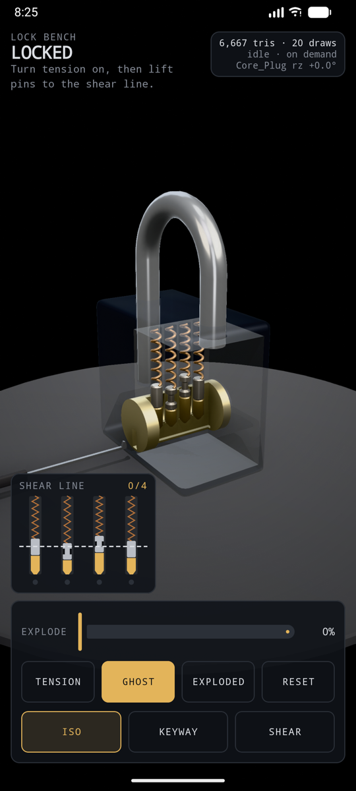
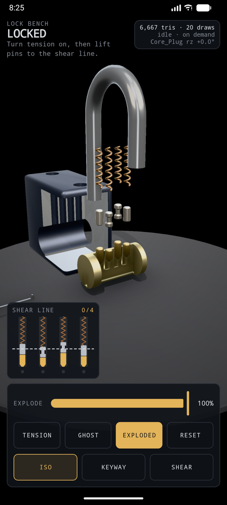

# Lock Bench

An Android lockpicking bench: a 3D cutaway pin-tumbler padlock you can pick with your finger. Put tension on the plug, lift the pins one at a time to the shear line, and watch the mechanism move inside the housing.

Built with Jetpack Compose and [SceneView](https://github.com/SceneView/sceneview) (Filament).

<p align="center">
  
  
  
  
</p>

<p align="center"><sub>Cutaway (ISO) · Shear line · Ghost · Exploded</sub></p>

## How to pick it

1. Tap **TENSION** to load the plug.
2. Drag up on a pin stack to lift it, or tap it to nudge it to the shear line.
3. Only one pin binds at a time. Set the binding pin and the plug creeps round, moving the bind to the next one.
4. Lift a binding pin too far and it oversets and jams. Release tension to drop every pin and start over.
5. Set all four and the shackle releases. Tap **RESET** to relock.

The **SHEAR LINE** panel shows each stack against the shear line, and you get haptic feedback as pins set.

## Views

| Control | What it does |
| --- | --- |
| **ISO / KEYWAY / SHEAR** | Camera presets. Tap the current one again to snap an orbited camera back. |
| **GHOST** | Makes the housing translucent. |
| **EXPLODED** / **EXPLODE** slider | Pulls the parts apart. |
| **RESET** | Relocks the padlock. |

Drag anywhere off the pins to orbit the camera, and pinch to zoom.

## Project layout

```
app/src/main/kotlin/com/lockpicking/bench/
  lock/LockMechanics.kt   pin-tumbler state machine (no Android, unit tested)
  lock/LockSession.kt     drives the mechanics from touch input
  lock/LockRig.kt         poses the glTF nodes from the lock state
  ui/LockBenchScreen.kt   SceneView scene, camera, touch handling
  ui/Hud.kt               shear line panel and controls
app/src/main/assets/
  models/cutaway_padlock.glb
  environments/studio.hdr
tools/
  build_padlock.py        Blender script that generates the padlock model
  make_studio_hdr.py      paints the studio lighting HDR
  inspect_glb.py          checks a .glb against the node contract
```

## Building

Requires JDK 17 and an Android SDK with API 37. Min SDK is 28.

```bash
./gradlew installDebug
```

Run the unit tests:

```bash
./gradlew test
```

### Regenerating the assets

The model and the lighting are generated from scripts, so you can change them in code:

```bash
/Applications/Blender.app/Contents/MacOS/Blender --background --python tools/build_padlock.py
```

```bash
python3 tools/make_studio_hdr.py
```

```bash
python3 tools/inspect_glb.py
```
