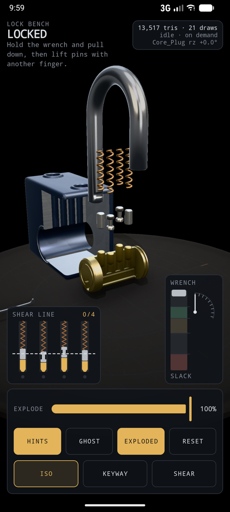
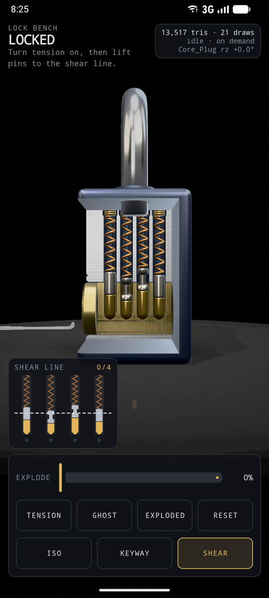

# A locksport primer

Lock Bench shows you the inside of a pin-tumbler padlock while you pick it. This page names the parts you are looking at and explains why picking works at all. For the controls, see the [README](../README.md).

## What locksport is

Locksport is picking locks as a hobby: a mechanical puzzle you solve by feel. It has two rules that everyone in it keeps:

1. Only pick a lock you own, or one its owner has told you to pick.
2. Never pick a lock that is in use, even your own front door. A lock can be damaged by picking, and one that is guarding something is not a toy.

Laws about owning picks differ from place to place. Look up yours before you buy any.

## The parts

  

Turn on **EXPLODED** in the **BENCH** drawer to pull the lock apart like this, or **GHOST** to see through the housing.

| Part | What it is | Where to look |
| --- | --- | --- |
| **Housing** | The body of the lock. It holds everything still. | The outer block. GHOST makes it see-through. |
| **Shackle** | The U-shaped bar that latches into the housing. | On top. It springs up when the lock opens. |
| **Plug** | The cylinder that turns. Turning it is what opens the lock. | The round core through the middle, with the keyway cut in it. |
| **Keyway** | The slot in the plug where the key, or the pick, goes. | The front face of the lock, and the KEYWAY camera. |
| **Chambers** | The holes drilled down through the housing and into the plug, one per pin stack. | The columns in the cutaway. |
| **Key pin** | The bottom pin of each stack. It touches the key, and each one is a different length. | The lower pin in each column, sitting in the plug. |
| **Driver pin** | The top pin of each stack, pushed down by its spring. While it crosses into the plug, the plug can't turn. | The upper pin in each column, sitting in the housing. |
| **Spring** | Pushes each stack down into the plug. | The coils at the top of each chamber. |
| **Shear line** | The gap between the plug and the housing. A stack is out of the way when the split between its key pin and driver lines up with it. | The line across the columns, best seen from the SHEAR camera. |
| **Land** | The solid metal between two chambers. The pick can push on it, but nothing moves. | The spaces between the columns. |

A key pin, a driver and a spring make a **pin stack**. The trainer and the Master No. 3 have four stacks; the American 1100 has five.

## How a key opens it

With no key in, every driver pin sits half in the plug and half in the housing, pinning the two together. A key's cuts are each the right depth to lift its key pin until the top of that pin is exactly at the shear line. Then every driver is fully in the housing, every key pin is fully in the plug, and nothing crosses the gap. The plug turns, and turning it lets the shackle go.

A wrong key lifts some pins too little and some too far, so something always crosses the gap.

## Why picking works

  

If every chamber were drilled in a perfectly straight line, turning the plug would press on every driver at once and you could never move one on its own. Real locks are made with small errors. The chambers are a hair out of line, so when you turn the plug a little, one driver catches on the edge of its chamber before the others do. That one is the **binding pin**, and it is the only one holding the plug.

Lift the binding pin to the shear line and its driver slips up into the housing. The plug turns a tiny bit more, then stops on the next pin to catch. That is a **set**. Do it once for every stack and the plug turns free.

The order the pins bind in is the **binding order**. It is set by how a lock was made, not by where the pins are, so you have to find it each time. On the bench, the needle on the **WRENCH** dial shows the plug creeping round with each set. In a blind round the binding order is shuffled for every lock, so you can't learn it, only feel for it.

## Tension

A **tension wrench** is the tool that turns the plug while you pick. In the app it is the **WRENCH** zone under your left thumb.

Tension does three jobs: it makes one pin bind, it holds the set pins up once their drivers are past the shear line, and it tells you how the lock is moving. Too little and set pins fall back down. Too much and the binding pin is pinched so hard it won't lift: it **seizes**. Let go altogether and every pin drops and you start again.

Most of picking is learning how light tension can be. The marks on the WRENCH zone show where pins move freely and where they seize.

## Single-pin picking

Picking one pin at a time is **single-pin picking** (SPP). It is what the bench simulates:

1. Hold light tension.
2. Slide the pick along the pins and feel each one. Pins that are not binding move up easily on their springs and drop back. The binding pin feels stiff and scratchy.
3. Lift the binding pin until it clicks. That is a set.
4. Find the next binding pin and repeat.

Push a pin too far and its key pin crosses the shear line instead of the driver: it **oversets**, and it jams the plug just as well. Ease the tension and it drops back.

## Security pins

Plain drivers are flat cylinders. Most locks sold today also have **security pins**, drivers shaped to make picking harder.

| Pin | What it does | What you see in the app |
| --- | --- | --- |
| **Standard** | A plain cylinder. Lift it, it sets. | The Master No. 3 has only these. |
| **Spool** | Thin in the middle, like a cotton reel. When it is lifted, its thin waist can sit on the shear line and let the plug turn much further than a real set. That is a **false set**. To beat it, keep lifting the spool and ease off the wrench until the plug turns back a little, called **counter-rotation**, and the spool sets. | Pins 2 and 3 on the trainer, pins 2 and 4 on the American 1100. The plug jumps round and hangs. |
| **Serrated** | Ringed with fine grooves. Each groove clicks as it passes the shear line, so it feels like a set when it isn't. With heavy tension a groove catches and holds the pin. Keep tension light and keep lifting through the clicks. | Pins 1, 3 and 5 on the American 1100. |

## Raking

A **rake** is a pick with a wavy blade. Instead of finding one pin at a time, you scrub it in and out under all of them with a light wrench, changing how high you hold it as you go. Each hump kicks the pins up as it passes, and whichever pin is binding at that moment sets. On a lock of plain pins it is fast and takes little skill, which is why cheap padlocks are said to rake open.

It is light tension or nothing. A rake cannot feel for the shear line the way a hook does, so it throws pins past it: under a light wrench they fall back, and under a firm one they jam.

Security pins are made to stop it:

| Pin | What a rake does to it |
| --- | --- |
| **Standard** | Sets as a hump passes under it. |
| **Spool** | Gets knocked about without ever squaring up to the plug, so it does not set. Once the other pins have gone the plug drops into a false set, and from there the spool has to be eased up over its shoulder while the plug turns back. A passing hump cannot do that. |
| **Serrated** | Clicks on its first groove every pass and falls back. Each groove has to be pushed through steadily. |

So raking gets you as far as the security pins and no further. From there you slow down until the blade is almost still and **rock** one hump up and down under the pin, which is single-pin picking with the wrong tool, or you swap to the hook. In the app the **HOOK | RAKE** switch is on the pick pad, and swapping keeps your tension and your sets.

## The locks on the bench

They are bench models, made in the style of real locks, not copies of them.

- **MASTER NO. 3**: four standard pins. Start here.
- **TRAINER**: four pins, two of them spools. Where you learn false sets.
- **AMERICAN 1100**: five pins, three serrated and two spools, packed closer together. The hard one.

## Glossary

| Word | Meaning |
| --- | --- |
| **Binding pin** | The pin holding the plug right now. The only one worth lifting. |
| **Binding order** | The order the pins bind in, set by how the lock was made. |
| **Chamber** | A hole that holds one pin stack. |
| **Counter-rotation** | The plug turning back a little while a spool sets. |
| **Driver pin** | The top pin of a stack, which blocks the shear line. |
| **False set** | The plug turning far on a spool's waist. Feels like progress; is not open. |
| **Key pin** | The bottom pin of a stack, which the key or pick lifts. |
| **Land** | The solid metal between two chambers. |
| **Overset** | A pin pushed too far, so its key pin blocks the shear line. |
| **Pin stack** | A key pin, a driver and a spring in one chamber. |
| **Plug** | The part of the lock that turns. |
| **Rake** | A wavy pick scrubbed under all the pins at once. Raking is using one. |
| **Rocking** | Working one hump of a rake slowly up and down under a single pin. |
| **Seize** | A binding pin pinched too hard to lift, from too much tension. |
| **Serrated pin** | A driver with grooves that click like false sets. |
| **Set** | A pin lifted to the shear line and held there by tension. |
| **Shear line** | The gap between plug and housing that every stack has to clear. |
| **SPP** | Single-pin picking: setting the pins one at a time. |
| **Spool pin** | A driver with a thin waist that causes false sets. |
| **Tension wrench** | The tool that turns the plug while you pick. |

## Going further

If the bench gets you interested, the next step is a real practice lock: clear acrylic and cutaway locks let you watch the pins move, the same as here. Many cities have a locksport club where people bring locks to share and swap. Keep to the two rules.
